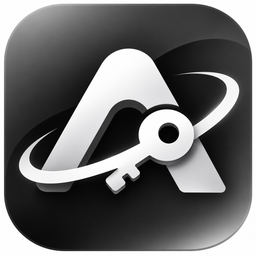

# AutoLogin

<p align="center">
  
</p>

<p align="center">
  <a href="https://github.com/AptimLvStic/AutoLogin/releases/tag/v1.0.0">
    
  </a>
  
  
</p>

AutoLogin 是一款面向 Windows 10/11 x64 的本地优先登录工作台。它不只保存密码，还会记住你在某个站点上的完整登录流程，下次点一下即可重放。

当前版本为 `1.0.0`。桌面外壳使用 Tauri 2，账号、密码、配置、书签和日志都保存在本机；没有 AutoLogin 云账号、云同步或遥测。软件不会绕过验证码、短信验证、二次验证或网站风控。

## 为什么还要一个密码管理器

Bitwarden、1Password、KeePass 都能保存密码和自动填充，但遇到 SSO 中转、前置验证码、二次跳转或非标准表单时，通用填充仍可能失效。

AutoLogin 的做法是：把一次成功的登录过程完整演一遍，记录点击、输入和页面元素选择器，之后按步骤重放；回放失败时，再回退到通用表单识别。对于需要每天登录多个内部系统的场景，这比反复复制粘贴更直接。

## 核心能力

### 自动登录

- 录制并回放多步骤登录流程，支持编辑动作类型、Selector、拖拽排序和逐条测试。
- 优先回放已保存流程，失败后自动回退到通用用户名 / 密码字段识别。
- 自动填充脚本运行在默认浏览器的独立 CDP world 中，目标页面无法直接访问注入接口。
- 支持“自动识别”和“手动配置”两种模式。手动配置可以自由增删步骤，不限制固定的用户名、密码、提交按钮三行。
- 检测验证码或二次验证区域时停止自动提交，把后续操作交给用户。

### 批量登录

- 所选账号会在同一浏览器窗口的多个标签页中依次打开。
- 结果分为成功、失败、待人工处理，并实时显示数量。
- 成功、失败、超时和人工接管记录写入本地脱敏日志，可按日期、站点、分组和状态筛选、分页及批量清理。
- 日志只保存时间、批次、账号名称、站点名称、状态和脱敏原因，不保存密码、Cookie、验证码或完整 URL。

### 数据库、账号与书签

- 支持多个数据库标签页，格式包括 `.autologin`、`.kdbx`、`.csv` 和浏览器书签 `.html` / `.htm`。
- 标签名称与数据库文件名绑定；重命名数据库时同步重命名磁盘文件，并保留原文件后缀。
- 支持导入 KDBX、标准 CSV 和浏览器导出的书签 HTML；支持导出 AutoLogin、CSV、KDBX 和浏览器书签格式。
- 账号支持站点、分组、多账号、搜索、批量打开、列宽调整和显示列配置。
- 书签支持分组、访问默认浏览器和批量打开，不包含账号密码、自动提交或登录流程。
- 账号与书签共用回收站，可恢复或永久删除，并显示记录来源标签。
- 内置密码生成器、闲置自动锁定、三语界面、亮暗模式、主题与界面比例、网络代理和数据目录迁移。

## 安全设计

| 环节 | 实现 |
| --- | --- |
| 主密码派生 | Argon2id，64 MiB 内存、3 次迭代、并行度 1 |
| 保险库加密 | AES-256-GCM，使用随机 16 字节盐和 12 字节 nonce |
| 落盘方式 | 临时文件 → `fsync` → 原子替换，失败时回滚 |
| 主密码 | 只在本地 sidecar 内存中使用，不写入磁盘，锁定时清理 |
| 启动备份 | 加密快照滚动保留最新 3 份 |
| 浏览器自动化 | 通过仅绑定 `127.0.0.1` 的随机 CDP 端口连接 Chrome / Edge |
| 页面隔离 | 自动填充代码运行在独立的 `autologin-agent` world |
| 网络行为 | 无遥测、无云同步、无远程字体、不请求远程 favicon |
| 剪贴板 | 复制密码 30 秒后，仅在内容未变化时自动清除 |

为兼容使用 IP 地址、自签名证书或私有 CA 的内网站点，AutoLogin 启动的受管 Chromium 会忽略证书链错误。该设置不修改系统浏览器或其他浏览器窗口，但会降低受管会话对中间人攻击的防护，请仅在可信网络中使用。

> **CSV 是明文格式。** 导出的 CSV 包含账号和密码明文；导入的原始 CSV 也由用户自行保管。AutoLogin 只把解析后的记录写入加密保险库，不会把 CSV 原文件加密。

更完整的数据处理说明见 [PRIVACY.md](PRIVACY.md)。

## 浏览器支持

AutoLogin 不在应用内嵌网页，而是调用 Windows 默认浏览器，并通过 CDP 连接受管会话。

| 浏览器 | 支持状态 |
| --- | --- |
| Google Chrome | 支持并作为主要测试目标 |
| Microsoft Edge | 支持并作为主要测试目标 |
| 其他 Chromium 变体 | 未正式验证，兼容性不作保证 |
| Firefox | 不支持 |
| Internet Explorer | 不支持 |

如果默认浏览器为 Firefox 或 IE，请先将 Chrome 或 Edge 设为 Windows 默认浏览器。

## 下载安装

- 最新版本：[AutoLogin v1.0.0](https://github.com/AptimLvStic/AutoLogin/releases/tag/v1.0.0)
- 当前安装包：`AutoLogin_1.0.0_x64-setup.exe`
- 安装包尚未配置 Authenticode 代码签名，Windows SmartScreen 可能显示“未知发布者”提示。

首次启动会要求创建主密码。主密码无法找回，也没有后门；忘记后只能清除本机数据并重新创建保险库。

安装版支持应用内更新。更新源优先使用项目 CDN，CDN 不可用时回退到 GitHub Releases。

## 数据保存位置

默认数据目录为：

```text
%APPDATA%\AutoLogin
```

可在“设置 → 数据保存位置”中迁移到其他本地目录。自定义路径会持久化到 `%APPDATA%\AutoLogin` 下的位置指针，常规覆盖升级不会把它重置为默认目录。

目录中的主要文件：

```text
%APPDATA%\AutoLogin\
├─ vault.enc
├─ vault.enc.bak
├─ data-location.json
├─ data-location.bak.json
├─ backups\
├─ tabs\
│  ├─ autologin\<数据库名>.autologin
│  ├─ kdbx\<数据库名>.kdbx
│  ├─ csv\<数据库名>.csv
│  └─ bookmarks\<数据库名>.html
├─ BrowserProfiles\
├─ session-index.json
└─ logs\
   ├─ app.jsonl
   └─ login-failures.jsonl
```

- 关闭数据库标签页只隐藏页面，不会删除对应的磁盘文件。
- 本地库和 AutoLogin 导出库使用 AES-256-GCM 加密。
- KDBX、CSV 和书签文件按原格式保存在各自目录中。
- 网站 Cookie、缓存和本地存储由 Windows 默认浏览器及用户级机制保护，不受保险库主密码直接加密。
- 卸载程序默认保留用户数据；如需彻底删除，请先在设置中执行“清除全部本地数据”。

## 技术架构

```text
┌──────────────────────────────────────────────┐
│ Rust / Tauri 2 桌面外壳                       │
│ 窗口管理 · IPC 路由 · Sidecar 生命周期 · 更新  │
├──────────────────────────────────────────────┤
│ Node.js Sidecar                              │
│ 保险库 · CDP 自动化 · 导入导出 · 日志         │
├──────────────────────────────────────────────┤
│ React 渲染层                                 │
│ 界面 · 表单 · 状态管理 · 多语言               │
└──────────────────────────────────────────────┘
                   │ JSON-RPC
                   ▼
      Windows 默认 Chrome / Edge（CDP）
```

主要目录：

```text
src/main/        本地业务层、保险库、导入导出、浏览器自动化
src/preload/     自动填充代理源码
src/renderer/    React 界面与样式
src/shared/      共享类型、Schema、URL 与数据库文件规则
src/tauri/       Node sidecar 入口与桌面 API 适配层
src-tauri/       Rust 桌面外壳、IPC、窗口与打包配置
tests/           Unit / E2E 测试
resources/       应用图标与更新配置
```

## 从源码运行

前置环境：

- Windows 10 22H2 或 Windows 11 x64
- Node.js 22 或更新版本
- Rust `1.90` 或更新版本
- Visual Studio C++ Build Tools 与 Windows 10/11 SDK
- Microsoft Edge WebView2 Runtime

安装依赖并启动开发环境：

```powershell
npm ci
npm run dev
```

类型检查、单元测试与生产构建：

```powershell
npm run typecheck
npm test
npm run build
```

Tauri NSIS 安装包输出到：

```text
src-tauri/target/release/bundle/nsis/
```

也可直接使用：

```powershell
npm run package
```

## 已知限制

- 不绕过验证码、短信验证、2FA 或网站风控。
- 自动填充只正式支持 Windows 默认的 Google Chrome 和 Microsoft Edge。
- 同一批次内不要同时登录同一站点的多个账号；批量登录共享受管配置目录，Cookie 可能互相覆盖。
- KDBX 导入只支持使用主密码的 `.kdbx` 数据库，不读取密钥文件、附件或 TOTP 字段。
- CSV 文件包含明文账号密码，使用和删除时需自行注意安全。
- 不承诺兼容所有登录页，尤其是强反自动化、要求浏览器扩展或受企业策略限制的网站。
- 未签名安装包可能触发 Windows SmartScreen 提示。

## 隐私

AutoLogin 不收集遥测，不上传保险库、账号、密码或浏览记录。只有执行应用更新检查或用户主动打开站点时，才会发起相应的 HTTPS 请求。

详见 [PRIVACY.md](PRIVACY.md)。

## 反馈

- 问题与建议：[GitHub Issues](https://github.com/AptimLvStic/AutoLogin/issues)
- 发布记录：[GitHub Releases](https://github.com/AptimLvStic/AutoLogin/releases)

提交日志或截图前，请先移除真实账号、密码、Cookie、数据库文件和内网地址。

## 许可证

当前仓库标记为 `UNLICENSED`，尚未提供 `LICENSE` 文件。除仓库中明确声明的内容外，不授予复制、分发、修改或商业使用许可。
